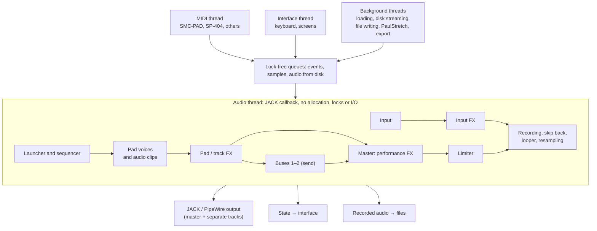

> **This is a vision, not requirements.** We wrote this document before development started. It will almost certainly change after the first working version. The source of truth is `openspec/specs/` and the active changes. We take ideas for future changes from this document. We do not implement anything "along the way".

# Technical brief: the ptsr terminal sampler

Version 3 · 03.11.2026 · project name: ptsr. Version 3 adds modulation, pattern ideas, slice ideas, the controller-first goal and visual control (sections 12, 16a, 17, 20, 22, 24). The detailed plans for the next changes are in [plans/README.md](plans/README.md).

Current status: change 82 (shared FX and X-Session defaults) is accepted and archived.
The next work is keymap cleanup (83a), input parity, visual control, SMC-PAD integration
and then patterns.
These are plans, not shipped features. See `docs/PROJECT.md` for the current state.
SMC-PAD hardware details below are reference assumptions until change 91 measures the
owner's device on Linux.

## 1. Goal and context

ptsr is a terminal sampler-groovebox for Linux. You control it from MIDI pads and from the keyboard, without a mouse. It is a hybrid of two schools:

- **From Akai MPC**: the data model. This is a shared sample pool, programs, pads with layers, keygroup instruments, tracks and an arrangement.
- **From Roland SP-404 MK2**: live work. This is effect buses, a performance effect, skip back, one-button resampling, DJ mode and a looper.

The main difference from both: patterns and audio clips launch in parallel, like "blocks" in a clip launcher. The model is Session View in Ableton and Clip Launcher in Bitwig. On the SP-404, one pattern plays at a time. Here, any number of tracks play at the same time.

The sound goals include chopped beats, digital debris and stretched textures.

The instrument has two equal purposes:

- **Live play**: nothing blocks the sound or crashes the program. All important controls are under the fingers.
- **Studio**: non-destructive editing, resampling, PaulStretch, and assembly of a full track inside the sampler.

An AI agent writes the code. The project owner does not read the code. Thus an automated test with a WAV render checks each feature, and the owner checks it by ear (section 21).

The owner's priorities: 1) chopping and the sample editor, 2) live effects, 3) the sequencer and the launcher, 4) PaulStretch and textures.

## 2. Platform and stack

The target platform is Linux on a laptop or a PC. Raspberry Pi is possible in the future. Thus the code must not depend on x86, and we measure the CPU load.

| Layer | Choice | Why |
| --- | --- | --- |
| Language | Rust (stable) | the compiler finds thread races, no garbage collector |
| Sound | `jack` through PipeWire-JACK, fallback `cpal` | low latency, routing in qpwgraph |
| MIDI | `midir` (ALSA) | more than one device, hotplug |
| Interface | `ratatui` + `crossterm` | terminal UI, kitty keyboard protocol |
| Waveform | `ratatui-image` (kitty graphics / sixel), fallback mode: Braille characters | pixel graphics in the terminal |
| Audio read and write | `symphonia` (WAV, FLAC, AIFF, MP3, OGG), `hound` | |
| DSP | `fundsp`, own code, Faust → Rust | basic blocks and high-quality effects |
| FFT | `rustfft` | PaulStretch, vocoder, analysis |
| Transients and BPM | `aubio` (bindings) | chopping by hits, tempo detection |
| Time stretch | Signalsmith Stretch or Rubber Band | tempo sync of clips |
| Configs and projects | `serde` + TOML | a person can read and edit them by hand |
| Queues between threads | `rtrb` (lock-free) | no locks in the audio thread |

The project license is **GPL-3.0**. The project can use GPL code (PaulXStretch, Rubber Band) and LGPL Faust libraries. The agent checks the license of each new dependency for compatibility with GPL-3.0.

The target terminal is kitty, WezTerm, foot or Ghostty. The program needs the extended keyboard protocol (physical keys, release events) and graphics. In other terminals, the program uses a simplified mode and shows a warning at startup.

## 3. Hardware and MIDI

| Device | Role | Connection |
| --- | --- | --- |
| M-VAVE SMC-PAD | main controller: 16 velocity pads with pressure (two layers with PAD BANK), 8 endless encoders (two banks with KNOB BANK), 5 buttons that send MIDI (LEFT, RIGHT, PLAY, STOP, RECORD); SHIFT, PAD BANK, KNOB BANK and Note Repeat are local and send nothing | USB-MIDI (the first versions do not support Bluetooth) |
| Roland SP-404 MK2 | controller, sound card, external instrument that follows the MIDI clock | USB (audio + MIDI), no hub |
| Computer keyboard | pads, navigation, commands | terminal with the kitty protocol |
| Any MIDI device | notes and CC through the mapping from the config | USB-MIDI |

Requirements:

- More than one MIDI input and output operate at the same time.
- Hotplug and unplug occur without a restart and without a sound dropout.
- The device mapping is a TOML file: notes → pads, CC → encoders, buttons → commands. The program identifies the device by its port name.
- MIDI learn: you select a command or a parameter and turn a knob. The program binds the knob and saves the binding to the mapping.
- The SMC-PAD encoders are endless. The program supports absolute and relative CC. The mapping sets the type.
- MIDI debug screen: it shows the latest incoming messages with device, channel, note/CC and value.

The keyboard pads are a 4×4 block of **physical** keys: `1 2 3 4` / `Q W E R` / `A S D F` / `Z X C V`. They operate with all layouts, the Russian layout too. They send the key release for gate mode. Keyboard velocity is fixed (100 by default). With Shift, it is 127.

## 4. Architecture

The program has separate threads. Thus the sound never waits for the interface, the disk or MIDI.



All threads communicate with the audio thread only through lock-free queues. In the other direction, the audio thread sends state snapshots for the screen and audio for the file writer.

The code is a workspace of separate crates:

- `engine`: the audio engine. It contains voices, tracks, the launcher, the sequencer, buses and timing. It does not depend on the interface. It operates with JACK and in offline render for tests.
- `dsp`: effects, PaulStretch, time stretch. These are pure functions on buffers.
- `midi`: devices, mappings, MIDI learn, clock.
- `library` and `project`: the sample library, the project model, packing.
- `tui`: screens, hotkeys, the command palette.
- `app`: assembly into a program, configs, logs.

With this split, we can add a web editor on top of the same engine later.

## 5. Data model

```
Library (shared by all projects)
└── Sample (BLAKE3 hash, metadata, tags)

Project
├── Programs
│   ├── Drum program: 16 pads × 8 banks = 128 pads
│   │   └── Pad: up to 4 layers → each layer = sample reference + chopping + parameters
│   └── Keygroup program: zones by notes, each zone has up to 4 layers
├── Tracks (up to 32)
│   ├── MIDI track → plays one program
│   └── Audio track → plays audio clips
├── Launcher: grid of tracks × scenes (up to 64 scenes)
│   └── Clip = pattern (for a MIDI track) or audio clip (for an audio track)
├── Arrangement: a linear timeline that holds clips
├── Buses, performance effect, master
└── Mappings, keymap, project settings
```

All editing is non-destructive. Samples in the library do not change. The project keeps chopping, trims and fades as parameters. "Bake" is a separate command. It renders the result into a new library sample.

## 6. Sample library and projects

**Library** (`~/ptsr/samples/`):

- The library keeps each file one time, under its BLAKE3 hash. There are no duplicates.
- Import copies the file into the library. The source file does not change. Formats: WAV, FLAC, AIFF, MP3, OGG.
- Metadata: original name, duration, sample rate, channels, BPM (if detected), tags, date added.
- Search by name and tags. Filters by tags and duration. Preview directly from the list (loops play in the project tempo).
- **Automatic categories:** analyse each sample once and propose a tag: kick, snare, hat, cymbal, perc, bass, texture, vocal or loop.
  The owner can correct the tag. It works like other tags.
- **Similar sounds:** find samples that sound like the selected sample, from its spectrum, envelope and length.
  This works in the file browser and on a pad.
- Input recordings, resamples and baked results go into the library immediately, with the tags `rec`, `resample`, `baked`.

**Project** (`~/ptsr/projects/<name>/`):

- `project.toml`: tempo, programs, tracks, clips, scenes, arrangement, buses, mappings.
- Autosave every 60 seconds and on exit. The program also keeps the 20 latest versions for rollback.

**Transfer:**

- "Pack project" collects `project.toml` and all used samples into a folder or a `.tar.zst` file.
- "Unpack" on a different machine adds the samples to the local library without duplicates. Then it restores the project.
- The program marks a missing sample as missing on the pad or the clip. The program does not crash.

## 7. Programs and pads

**Drum program**: 128 pads (8 banks of 16). Buttons or PageUp / PageDown switch the bank.

**Pad:**

- Up to 4 layers. Layer mode: by velocity (you set the ranges), round robin (in sequence), random, all at the same time (stack).
- Playback mode: one-shot, gate, loop (forward or ping-pong), reverse.
- Volume, pan, pitch (semitones and cents), envelope (attack, hold, decay, release), filter.
- Mute group: the pads in the group silence each other. Example: closed and open hi-hat.
- **Pad link**: one press triggers a group of pads.
- **Slice follow**: when a pad that plays a slice ends, it starts the next slice, a random slice, or a slice from a list. The break rebuilds itself while it plays. A follow chain stops at a set count or on the next hit.
- 2 effect slots, send to buses 1 and 2, output (master or a separate JACK channel).
- BPM sync: time stretch makes a loop follow the project tempo.
- **Pad presets:** save envelope, filter, pitch, mode, mute group, sends and the pad's own effects, when available, without the sample.
  Apply a preset to another pad or the marked pads.
- **Kits:** save and load one bank of 16 pads with their samples and settings.
  Import a folder of WAV files as a kit, in name order.
- **Sound variation per hit:** set random amounts per pad for start point, pitch, filter cutoff and volume.
  These change the sound. Humanize in section 12 changes only timing and velocity.
- **Folder round robin:** each hit plays the next sample from a folder, or selects a random sample from that folder.

**16 Levels:** the program spreads the selected pad across 16 pads. On these pads, one parameter changes in steps from pad to pad. This parameter is pitch, volume, filter, decay or start point. The result is new pads in the same program. The source pad does not change.

**Keygroup program:** a sample or a set of samples plays by notes. The notes come from a MIDI keyboard, from the pads in chromatic mode, or from the piano roll. In chromatic mode, 16 pads are 16 degrees of the selected scale. Note zones have a root note, with up to 4 layers in a zone. Polyphony or mono with legato and portamento. This replaces the chromatic mode of the SP-404. It gives melodies and bass lines from samples.

- **Chord mode:** a pad plays a triad, a seventh chord or a custom note set in the project key.
- **Arpeggiator:** hold pads in chromatic or chord mode to play notes in tempo: up, down, up-down or random.
  Controls are rate (1/8–1/32, including triplets), octave range and gate.
- **Project key and tuning:** the project has a key and scale. Root-note detection proposes a sample note for owner confirmation.
  A tune command adjusts pad pitch to fit the root note to the key. The screen can show notes instead of semitones.

**Playhead mode:** the 16 pads are 16 start points in one long sample. A knob moves the window of the 16 points across the sample, and a second knob sets the window width. Each hit plays from its point. This is a quick way to play a long recording or a texture without chopping it first.

**Live mode:** it locks all functions that you do not need on stage (deletion, project change, editors). One button toggles it. The status line shows its state.

## 8. Editor and chopping

The editor is the core of the first version. It chops a sample into slices and lays them out on pads. You can do all of this from the controller and the keyboard.

**Chopping modes:**

1. Equal parts: 2, 4, 8, 16, 32 slices.
2. By transients: aubio detector, threshold on an encoder. Markers appear and disappear immediately when you turn the encoder.
3. By the tempo grid: markers on beats (1/4, 1/8, 1/16). The program detects the BPM automatically, or you set it.
4. Manually: add, move or delete a marker.

The chopping result is a new drum program. Or it is slices on the pads of the current program, from the selected pad onward. The source sample does not change.

**Operations on a sample or a slice:** trim, snap of points to zero crossings, fades with a curve shape, normalize, gain, reverse, loop points, "bake", resampling of a slice with effects to a new pad.

**Quick sample operations:** one key or one panel cell for each operation, without opening the full editor.
All operations stay non-destructive until bake.

- Trim silence from the start and end, with a threshold setting.
- Fade in and fade out, with a length setting.
- Reverse.
- Loop with a crossfade for loop and gate pads, with a crossfade-length setting.
- Remove DC offset.

**Encoders on the chopping screen:**

| Encoder | Function |
| --- | --- |
| 1 | cursor or marker, coarse |
| 2 | cursor or marker, fine |
| 3 | zoom |
| 4 | transient threshold |
| 5 | slice pitch |
| 6 | slice filter |
| 7 | fade of the selected edge |
| 8 | slice volume |

During chopping, the pads preview the slices. Undo/redo applies to all project edits. The history keeps at least 100 steps.

Waveform: pixel graphics through the kitty protocol. In other terminals, Braille characters. The waveform shows the markers, the selected slice and the playback position.

## 9. Recording, skip back, resampling, looper

- **Recording source**: any JACK/PipeWire input, mono or stereo. Monitoring has a level meter and a clipping warning.
- **Recording to a pad**: start immediately, on a volume threshold, or at the start of a bar.
- **Recording to an audio clip** on an audio track: into the selected launcher cell. The length is a multiple of bars, or free.
- **Skip back**: the program always records the last 60 seconds of the input and the master. You can configure the length. One button saves this audio to a pad or a clip.
- **Resampling**: the program records the master, a bus or a track, with its effects, to a new pad or a clip.
- **Live slicing**: the program records the input or the master and cuts the recording by hits at once. The slices go onto the pads without the chop screen. The owner can open the chop screen later to correct the cuts.
- **Looper**: live loop recording with layer overdub and undo of the last layer. The loop length is in bars, in sync with the tempo. You can save the result to a clip or a pad.
- **Record through effects:** the input can pass through the effect chain before recording (section 10).
- **Input noise gate:** a threshold controls the gate.
- **Auto-start by threshold:** arm recording, then start on the first sound above the threshold.
  A short pre-roll keeps the attack.

The program saves recordings as 32-bit float WAV at the system sample rate. The recordings go into the library immediately. A separate thread writes the files. The audio thread only puts data into a queue.

## 10. Effects

Effects are in five locations:

- **Pad**: 2 slots, "glued" to the sound.
- **Track**: 2 slots on each launcher track.
- **Buses 1 and 2 (send)**: a chain of up to 3 effects. By default, bus 1 is a reverb and bus 2 is a delay.
- **Performance effect on the master**: one active "live" effect. When you select it, encoders 1–8 immediately become its knobs. Hold the button to turn it on temporarily.
- **Input**: one slot. It operates during recording and monitoring.

**Sidechain (ducking):** a pad, a track or a bus can make another part quieter while it sounds. Example: the kick makes the texture and the reverb tail quieter, so the mix "breathes". Settings: source, amount, attack, release.

Each effect has up to 8 parameters, dry/wet and bypass. The program smooths parameter changes without clicks. Patterns record parameters and effect on/off as automation. The limiter on the master is always on.

**Effect set by stage:**

| Stage | Effects | Source |
| --- | --- | --- |
| 1 | filter (LP/HP/BP, resonance), bitcrush, sample rate reduction, distortion and saturation, delay with a filter in the feedback, simple reverb | own code + fundsp |
| 2 | tempo-synced stutter and retrigger, DJFX looper (loops a piece of the master), isolator (3 bands), tremolo and autopan, tempo-synced gate, "vinyl" and "cassette", back spin, compressor and limiter | own code + Faust |
| 3 | granular delay, granular "freeze", zita_rev reverb, chromatic pitch shifter, resonator, chorus and flanger | own code + Faust |
| 3 | vocal: vocoder (carrier: pad, track or keygroup), autopitch, harmonizer | own code + Faust |
| later | installed LV2 plugins (LSP, Calf, x42, Dragonfly) | `lilv` |

## 11. Clip launcher and scenes

The launcher is the main screen for live play. It is a grid. The columns are tracks, the rows are scenes, and the cells are clips ("blocks").

- Each track plays one clip. The tracks sound in parallel.
- Launch is quantized: at the next bar (default), on beats, on 2/4/8 bars, or immediately.
- A scene launches its full row at the same time. A "stop" button is on each track and on the full launcher.
- Clip: a pattern (MIDI track) or an audio clip (audio track). A clip has a name, a color, a length, loop on/off and an end action. End actions: repeat, next clip, stop, random (for generative sets).
- You can copy, duplicate and drag clips between cells from the keyboard and the controller.
- Each track has mute, solo, volume and send to buses.

**SMC-PAD in launcher mode:** 16 pads are a window of 4 tracks × 4 scenes. Arrows (or buttons) move the window on the grid. Pad lights show empty, stopped, playing and launch-pending clips.

## 12. Pattern sequencer

A pattern is the content of a MIDI track clip. Resolution is 960 ppqn. The audio thread counts timing in samples, not with the system timer.

- Length from 1 to 64 bars, time signature 4/4 (others later), tempo 40–300 BPM.
- Real-time recording with quantization (off, 1/4, 1/8, 1/16, 1/32, triplets) and overdub.
- **Step mode (like TR-REC):** a step grid. A pad adds or deletes a hit.
- **Substeps (ratchets):** 2, 3, 4, 6, 8 hits in a step, with decreasing or increasing volume.
- **Per-step parameters:** velocity, pitch, gate length, reverse, sample start point, trigger probability, off-grid shift (microtiming).
- **Parameter locks:** any pad parameter can have its own value on one step: filter, cutoff, decay, drive, sends, the slice. The step plays with this value, and the next step returns to the pad value. You set a lock in step mode: hold a step and turn a knob.
- **Row lengths (polyrhythm):** each pad row of a pattern can have its own length in steps, for example 12 steps for the hi-hat and 16 for the kick. The rows drift against each other and meet again after the common length.
- **Euclidean fill:** for one pad row, set the number of hits, the number of steps and the rotation. The program spreads the hits as evenly as possible. Two knobs change it live.
- **Mutations:** commands that change a pattern by chance: shuffle the slices on the pads, thin the hits, move hits by one step, swap two rows. Each mutation is one undo step, so you can roll again.
- **Humanize:** a small random change of time and velocity for each hit at playback. One knob sets the amount. The stored hits do not change.
- **Groove templates:** extract timing offsets and velocities from a break or recorded take, per step of a 1/16 or 1/32 grid.
  Save the result as a groove. Apply it to any pattern at playback, with amount 0–100 %.
  Include a few MPC-style swing grooves at 50–75 %. Like quantize, this is non-destructive and acts in pattern compilation.
- **Pattern variations:** each slot holds up to four variations (A/B/C/D) of one pattern. A variation starts as a copy.
  Switch at the next bar or loop end, as with slots.
- **Pattern chains:** an ordered list of slots with repeat counts, for example A1 ×4, A2 ×2, A3 ×1.
  Play and loop the chain. This is a light song mode before the launcher and scenes.
- **Recording takes:** keep each recording pass as a take. Listen and select one, or merge two.
  Undo still removes the last pass.
- **Piano roll** for keygroup programs.
- Swing 50–75 %, note repeat (roll) at the selected beat.
- Automation recording for effects and pads, effect on/off included.
- **Pad mute mode** during playback.
- Operations: copy, paste, double length, clear pad, shift by one step, change program.
- Metronome with a separate output (you can send it to headphones only).

## 13. Audio tracks and audio clips

- An audio clip is a reference to a library sample, with start, end and loop points.
- The program does not load long files into memory fully. A background thread reads them from disk with a read-ahead buffer (at least 2 seconds). A buffer underrun does not stop the sound. The problem counter records it.
- **Warp:** time stretch makes the clip follow the project tempo. The program detects the source tempo automatically, or you set it. Modes: "rhythmic" and "tonal".
- Fades at the clip edges, volume, pitch without tempo change.
- You can chop an audio clip onto pads (this opens the editor). You can also do the opposite: put a slice from a pad as a clip.

## 14. Song mode and arrangement

You assemble a full track inside the sampler.

1. **Performance recording:** the arrangement record button captures clip and scene launches from the launcher onto a linear timeline. Thus "block" juggling becomes a track.
2. **Arrangement timeline:** tracks are vertical, time is horizontal. You can move, trim and copy clips. Section markers: intro, verse, break.
3. **Timeline automation** for volume, send and effect parameters.
4. You can switch "launcher ↔ timeline" at any time. A clip launch from the launcher temporarily overrides the timeline on that track.

First we implement item 1 and a simple timeline without automation. The other items come later.

## 15. DJ mode

- Two decks. Each deck plays a sample, an audio clip or a pattern.
- Crossfader with a curve selection. Volume and filter on each deck.
- Deck tempo sync, pitch bend for manual beatmatching.
- Up to 8 cue points per sample: launch from a point, set a point during play.
- Quick loop (roll) by beat. The performance effect operates on top.
- Control: pads are cue points and loops. Encoders are the crossfader, volume, filters and tempo.

## 16. PaulStretch and textures

PaulStretch turns any sample, slice or clip into a long ambient texture. The reference is [PaulXStretch](https://sonosaurus.com/paulxstretch/) (GPL-3.0, we can use its code).

Algorithm: the program cuts the sound into overlapping windows and calculates an FFT for each window. It replaces the phases with random phases. It assembles the windows again. It reads the windows from the source more slowly than it plays them.

- **Offline stretch** (×2 … ×1000): a background render with progress. The result is a new pad, a new clip and a new library sample. The sound and the interface do not slow down.
- **Live "freeze":** while you hold a pad, the sound stays at one point. An encoder moves the point across the sample.
- **Parameters on encoders:** stretch, window size, position, pitch, spectral spread, tonal/noise, filter, volume.
- Spectral processing from PaulXStretch (harmonics, frequency shift, compression): after the basic version.

## 16a. Modulation and performance control

The sound moves without hands on the knobs, and one hand moves many parameters at a time.

- **LFOs:** each pad and each effect slot can have up to 2 LFOs. Shapes: sine, triangle, square, ramp, random steps, smooth random. The rate is free (Hz) or in tempo (1/16 … 8 bars). Targets: any pad or effect parameter, with an amount from −100 to +100 %. A pad LFO can restart on each hit or run freely.
- **Pad pressure:** the SMC-PAD sends pressure after a hit. The pressure of a sounding pad can move one or two of its parameters (for example cutoff and drive) or the note repeat rate. A setting per pad sets the target and the amount. Pressure is off by default.
- **Macros:** 8 macro knobs per project. One macro moves up to 8 parameters, each with its own range and direction. Example: one turn closes the filter and opens the reverb send.
- **Snapshots and morph:** a snapshot keeps the values of the pads, the effects and the macros. There are 8 snapshot slots per project. A knob morphs smoothly between two snapshots; a pad jumps to a snapshot on the next beat. Snapshots never change samples, slices or patterns.
- All modulation is smoothed. No change makes a click. The sequencer can record macro and morph moves as automation.

## 16b. Sample workflows: tempo, breaks, bass and mix

The owner needs these sample workflows in addition to the existing goals.
The plan describes musical tasks, not specific genres.

- **Tempo:** work at 170–180 BPM. Breaks such as Amen, Think and Apache, recorded at
  130–160 BPM, need to fit the project tempo.
- **Breaks:** chop by hits, rearrange slices, add quiet snare hits (ghost notes), rolls
  and fills. Half-time sections keep the same project tempo.
- **Bass:** play one bass sample as notes, with mono play and glide between notes.
  Each step needs its own filter, pitch and start point. The resample loop is record,
  process, record again, then chop.
- **Mix:** a dense, loud mix needs kick and snare sidechain, a clean mono sub, master
  compression and limiting, and a loudness meter.
- **Movement:** filter LFOs and delays need tempo sync, including 1/8, 3/16 and triplets.

The additions to changes 95–100 are in [plans/PATTERNS.md](plans/PATTERNS.md).
[plans/SAMPLE-WORKFLOWS.md](plans/SAMPLE-WORKFLOWS.md) plans changes 102–108 after the pattern base.
Time stretch without pitch change and the larger sound-design tools remain later work.
These are plans, not current capabilities or requirements.

## 17. Interface and control

You do all work without a mouse. The left hand is on the pads (1234/QWER/ASDF/ZXCV). The right hand is on navigation. Functions are on F-keys and Ctrl. There is no vim style. The mouse is an addition (clicks, drag of markers and clips). No function needs the mouse.

**Screens** (the original long-term idea, not the current or next keymap):

Today F1 is help, F2 Pads, F3 Chop, F4 FX, F6 Files, F10 learn and F12 Settings.
Change 98 proposes Pattern on F5, not F4. Keep these keys until a separate spec changes
them. The keys in use are in `config/keymap.toml`; the table below is historical.

| Key | Screen | Content |
| --- | --- | --- |
| F1 | Launcher | grid of tracks × scenes, launch of clips and scenes |
| F2 | Pads | 4×4 program, layers and parameters of the selected pad, levels |
| F3 | Chop | waveform, markers, slices |
| F4 | Sequencer | steps, substeps, step parameters, piano roll |
| F5 | Effects | pad, track, buses, performance, input |
| F6 | Arrangement | timeline, sections, automation |
| F7 | Mixer | tracks, buses, master, outputs |
| F8 | Recording | input, monitoring, skip back, looper, resampling |
| F9 | Stretch | PaulStretch: parameters, render, "freeze" |
| F10 | DJ | two decks, crossfader, cue points |
| F11 | Library | search, tags, preview, import |
| F12 | Settings | sound, MIDI devices, mappings, MIDI debug |

**Permanent elements:** the top line shows project, BPM, bar, transport, program and bank, live mode, audio latency and buffer dropouts. The bottom line shows hotkey hints for the current screen.

**Keyboard:**

- Arrows: navigation. Enter: confirm. Esc: back or cancel. Space: start/stop.
- PageUp / PageDown: bank. Tab / Shift+Tab: next/previous element.
- Ctrl+letter: actions. Ctrl+Z is undo; Ctrl+S saves. The cleanup 83a is implemented: Alt+R holds microphone recording, Chop normalize sits on Ctrl+G, Chop hits on H and Shift+H (one step back, stopping at -6 dB), Pads banks on U/O and values on J/L with the arrows, and Ctrl+C takes a pad copy. Ctrl+R is reserved for pattern recording (97), Ctrl+Y for redo and Ctrl+. for panic (93a). Owner keymaps and learned bindings keep working; moved-key flashes name the new keys.
- Ctrl+B stays the Files favorite key; bake needs a different key in its own change. Ctrl+D means duplicate or double where bound. Do not add Ctrl+Shift+letter defaults. Check new chords in both extended and legacy terminal input.
- **Ctrl+K: command palette.** Fuzzy search in Russian and English. It shows the hotkey of each command.
- You can remap all hotkeys in `keymap.toml`.

**Controller first:** after the start, every action that does not need typed text is possible from the SMC-PAD alone. A frequent action takes 1 press. Any other action takes not more than 2 presses, plus knob turns for values. The keyboard and the controller do the same thing for the same action. Typed text (names, the file filter) stays on the keyboard.

**Controller:** the SMC-PAD buttons have one role on every screen: PLAY plays or stops what the screen is about, STOP is back, RECORD records, LEFT and RIGHT turn the main list of the screen. **Hold STOP** and the pads become a command panel of 16 cells: the top row opens screens, the bottom row is FX, settings, undo and projects, the two middle rows are the commands of the screen. The screen shows the panel with labels in the physical layout while STOP is held. PAD BANK gives the same panel as a latch. With STOP held, LEFT is undo, RIGHT is redo and PLAY stops all sound (panic). The first knob bank works for the screen, the second knob bank is the same on every screen (the selected pad, the sends, the tempo, the master).

**Visual control:** at one look the owner sees what the pads do now, what plays, what records, what waits and what the last press did. Badges in the title line show the modes (yellow: the pads do something other than sound; cyan: on or playing; magenta: records, waits or asks). Pads show small glyphs for the mode (target, planned slice, step, erase). Messages have levels (done, info, warning, error), and an error stays until the next action; F1 keeps the last messages. A knob change shows the value on every screen. The status line shows the transport, the recording, the connected devices and the audio state. The hints name the controls of the device that the owner used last.

**Stage protection:** destructive actions need a confirmation. Live mode blocks them fully.

The interface operates in a separate thread and only reads the engine state. If the interface hangs, the sound does not stop. Redraw rate: 30–60 frames per second.

## 18. Export

The default format is 24-bit WAV at the system sample rate. Options: 16-bit, 32-bit float, FLAC.

- **Samples and slices:** a pad, a slice or a program into separate files with clear names (`drums_B05_03_snr.wav`). With or without the pad effects.
- **Render:** a clip, a scene or the full arrangement. Offline, faster than real time. Master and stems (tracks and buses as separate files). The program writes effect tails until they decay.
- **Live set recording:** the master output goes to a file while you play, without sound dropouts.
- **Multichannel output to JACK:** you can send tracks and buses as separate channels for recording in a DAW.

Export writes to the project `exports/` folder. It does not block the interface.

## 19. Integration with SP-404 MK2

The SP-404 MK2 connects through USB as class-compliant audio and MIDI (without a USB hub). It has three roles, by stage:

1. **Controller:** the SP-404 pads play the program pads. The program can play the SP-404 pads through the MIDI output.
2. **Sound card and external effects:** program or track output → SP-404 (process or record there). SP-404 output → recording and resampling in the program. The program warns about a feedback loop.
3. **MIDI clock:** the program is the master (clock, start, stop). On the SP-404, the sync source is USB. Or the program is the slave: it follows an external clock and smooths the jitter.

The official SP-404 editor is only for Mac and Windows. To transfer samples, use the SD card or resampling through USB audio.

## 20. Development stages

The next stage starts only after the previous stage passes the automated tests and the listening check.

### Version 0.1: a playable sampler

0. **Skeleton.** Sound through JACK/PipeWire. One keyboard pad plays a sample. Offline render to WAV. Measurement of the audio callback. *Done when:* 10 minutes without clicks, and the render test passes.
1. **Programs and pads.** The full data model from section 5 (also the parts that are not in use yet). Drum program 8×16. Velocity and round robin layers. Pad modes, mute groups. SMC-PAD and the 4×4 keyboard. TOML mappings, pads screen, MIDI debug, a minimal command palette. *Done when:* I play from the SMC-PAD and the keyboard at the same time, and gate operates with the Russian layout.
2. **Library and projects.** Import, hashes, tags, search, preview, `project.toml`, autosave. *Done when:* after a restart, the project opens in the same state.
3. **Editor and chopping.** All chopping modes, chopping into a new program, operations, undo/redo, waveform. *Done when:* I chop a break by transients from the controller, without the keyboard.
4. **Effects, stage 1.** Pad slots, two buses, performance effect, limiter, MIDI learn. *Done when:* I turn the filter and the bitcrush live, without clicks.
5. **Recording.** Input, monitoring, recording to a pad, skip back, resampling.

### Between 0.1 and 0.2: controller first and visual control

5a0. **Keymap cleanup:** consistent chords, moved-key notices, microphone on Alt+R,
reserved recording and redo keys, and pad copy (`docs/plans/KEYMAP-CLEANUP.md`). The J/L
choice on Pads is still open: proposed A changes values and moves banks to U/O.
5a. **Input refactor:** one route for keyboard and controller, named modes, button hold, relative encoders, confirm (`docs/plans/REFACTOR-INPUT.md`).
5b. **Visual control:** badges, pad glyphs, messages with levels, the value pop-up, the status line (`docs/plans/VISUAL.md`).
5c. **SMC-PAD:** the profile, the command panel, the reach test, panic and redo (`docs/plans/SMC-PAD-INTEGRATION.md`, `docs/plans/CROSS-CUTTING.md`).

### Version 0.2: patterns and the launcher

6. **Pattern sequencer:** transport, recording, quantization, overdub, step mode with substeps and step parameters, swing, note repeat, pad mute (`docs/plans/PATTERNS.md`). Then parameter locks, row lengths, Euclidean fill, mutations and humanize.
7. **Clip launcher and scenes**, tracks, mixer, launcher mode on the SMC-PAD.
8. **Time stretch, audio tracks and audio clips** with disk streaming and warp. Pad BPM sync.
9. **Pad link, live mode, 16 Levels.**
10. **Export** of samples, clips, stems. Set recording. Project packing.

### Version 0.3: a full track

11. **Song mode:** performance recording onto the timeline, a simple arrangement timeline.
12. **Keygroup programs**, chromatic mode on the pads, piano roll.
13. **SP-404 MK2:** MIDI clock (master and slave), audio routing, multichannel output to JACK.
14. **Timeline:** automation, sections, clip editing on the timeline.

### Version 0.4: textures and live features

15. **PaulStretch** offline and "freeze".
16. **Effects, stages 2–3** and vocal effects.
17. **Looper.**
18. **DJ mode.**
19. **UX polish:** command palette for all commands, mappings, themes.
20. **Modulation:** LFOs, pad pressure, macros, snapshots and morph (section 16a).
21. **Slices in motion:** slice follow, playhead mode, live slicing (sections 7 and 9), sidechain (section 10).

## 21. Testing and rules for the agent

The agent does not hear sound. Thus three checks apply to each feature: an automated test with offline render, a performance measurement, and a listening check by the owner. These rules move to `AGENTS.md` at the repository root.

**Real time (do not break these rules):**

- In the audio callback: no memory allocation, mutexes, I/O, logging or panics.
- Communication between threads: only lock-free queues and atomics.
- The program loads samples for pads into memory in advance. A background thread streams long audio clips. File load and file write occur in separate threads.
- The program smooths parameter changes. This prevents clicks.

**Tests:**

- Offline engine: it renders a scenario (hits, clip launches, parameters, time) to WAV without a sound card.
- Automated render checks: no NaN and infinities, no clipping above a set level, silence where silence is necessary, length and volume within tolerance.
- Reference renders for DSP blocks: the test shows the difference from the reference explicitly.
- Timing: pattern hits and clip launches land on the correct sample, with ±1 sample accuracy.
- Benchmark: the test load is 32 voices, 8 tracks and a full effect chain. With this load, the audio callback uses no more than 50 % of the buffer budget at 128 samples / 48 kHz.

**Observability:** the status line shows the CPU load of the audio thread, the buffer dropout counter (xruns) and the counter of streaming buffer underruns. The program writes a log to a file, with levels. The audio thread writes no logs.

**Process:**

- One feature is one branch or a series of commits. Make a commit after each working feature.
- After each development step, the agent puts WAV files into `renders/` for listening. The agent writes what the owner must check by ear.
- The agent does not add dependencies with a license that is not compatible with GPL-3.0.
- The agent does not change the `project.toml` format without a migration of old projects.

## 22. Open questions

- [ ] Which notes, CC and buttons the SMC-PAD sends by default. Other people measured it on Windows and over Bluetooth: pads notes 36–51 on channel 10 (52–67 on the second layer), encoders CC 30–37 (38–45), buttons CC 25–29. Check it on Linux on the MIDI debug screen.
- [ ] The MIDI TRS wiring type of the SMC-PAD (A or B). Is an adapter necessary for a direct connection to the SP-404?
- [ ] Absolute or relative CC on the SMC-PAD encoders. Factory: an absolute counter that stops at 0 and 127. MidiSuite can set them to relative (64 ± n). Do it once on the owner's device.
- [ ] SMC-PAD pad lights: can MIDI control the colors? Over Bluetooth, yes, when the Led field of a pad equals its note (velocity is the color). Over USB it was seen only on the third port. Not tested on Linux. The launcher needs this; the screen must work without it.
- [ ] The final project name.
- [ ] Is a web editor on top of the same engine necessary later?
- [ ] Raspberry Pi: decide before version 0.4. This lets us reserve a CPU budget for PaulStretch and granular effects.

## 23. Decisions after version 2

- **Controller independence.** The program operates with logical actions. Device profiles in TOML bind controls to actions for each screen. Few knobs → parameter pages. Many knobs → all parameters at the same time. No knobs → keyboard. Control labels come from the profile.
- **Soft takeover** for absolute knobs and faders, separately for each device.
- **More than one controller at the same time.** Example: SMC-PAD pads + X-Session Pro knobs.
- **M-Audio X-Session Pro**: the test controller. It has 12 knobs, 4 faders, a crossfader, 10 buttons and no pads.
- **Keyboard:** the left half is pads only. Commands are on the right half, arrows, F-keys and Ctrl+letter. Shift on pads is only hit strength. With arrows, Shift makes a smaller increment (fine step).
- **Help at the bottom of the screen**, by groups, with toggle states and a hint about the next action. Full help is on `F1`.
- **Chopping:** "on beat" with snap to hits. Coarse and fine marker moves. A large slice view with the envelope. Slice parameters pop up on change, instead of permanent tiles.
- **Work order:** SDD with OpenSpec. The first stage is loading, chopping, assignment to pads and pad play.

## 24. Decisions after version 3 (03.11.2026)

Defaults that wait for the owner are marked "(default)". The full list of questions is in `docs/plans/README.md`.

- **Controller first** (section 17): everything without typed text from the SMC-PAD; the keyboard stays the reference and loses nothing.
- **Keymap cleanup 83a** is implemented on `plan/controller-first-patterns`: J/L change
  values and U/O turn banks on Pads, H / Shift+H chop by hits, Ctrl+G normalizes, Alt+R
  records, Ctrl+C copies a pad, Tab switches the assign order. The owner checks are in
  `docs/LIVE-CHECKS.md` (section 83a); 84 waits until they pass.
- **One input route:** the keyboard and the controller go through one decision about what a press means. A test runs each input scenario from both.
- **Hold STOP is the command panel** (default). PAD BANK layer 2 is the same panel as a latch.
- **Destructive actions:** keep X-Session direct safe defaults unchanged. For the SMC panel, the proposed default is a visible question for destructive changes in both held and latched forms. Change 92 must record the owner's choice before code.
- **Visual control** (section 17): one badge model, levels for messages; yellow means "the pads do something other than sound" (default; changes `docs/ui/STYLE.md`).
- **Patterns:** the sequencer is in the audio thread; time in ticks (960 per quarter); a pattern keeps the hits as played, and quantize applies at playback (it is non-destructive); a pattern uses absolute pads 0–127 (default); one pattern plays at a time until the launcher exists (default).
- **New projects from the controller** get a date name; the owner can rename them from the keyboard.
- **Modulation, parameter locks and slice motion** (sections 7, 12, 16a) remain later ideas after the pattern sequencer.
  The priority below replaces the earlier parameter-locks-first order.
- **Sample workflows** (section 16b): extend 95–100 with fast grids, half-time, fills and velocity ramps.
  Changes 102–108 plan sample tempo, break patterns, locks, resampling, bass, mix and movement.
  Resolve callback budget failures before 95. Describe tasks without specific genre names.
  These plans do not authorize code.
- Priority after the pattern sequencer: groove templates, pattern variations and chains, quick sample operations.
